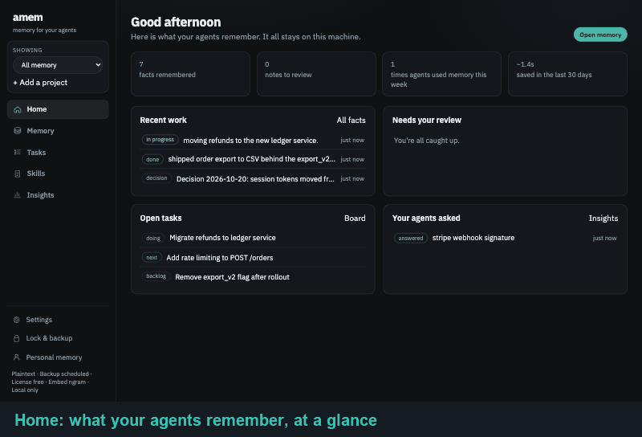

# amem

[](https://www.npmjs.com/package/@iamem/amem)
[](https://www.npmjs.com/package/@iamem/amem)
[](https://github.com/sslugic/amem/actions/workflows/ci.yml)
[](LICENSE)
[](https://nodejs.org)
[](https://modelcontextprotocol.io)
[](#privacy-non-negotiable)

[](https://mcprush.com/to/sslugic-amem-mcp?ref=badge) [](https://glama.ai/mcp/servers/sslugic/amem)

**amem — agent memory, anchored to your code.** Facts tied to the files they describe, skills and tasks, all in one SQLite file on your machine. Works with Claude Code, Cursor, Claude Desktop, Copilot, Codex, Gemini CLI, Qwen Code, OpenCode, Windsurf, Continue, Aider and Zed, on macOS, Linux and Windows.

```bash
npx @iamem/amem setup --platform claude   # or cursor, codex, copilot …
```



[Website](https://getamem.com) · [Features](https://getamem.com/features) · [Why amem](https://getamem.com/why) · [How it works](https://getamem.com/what)
Coding agents forget between sessions. They re-read the same files, re-learn the same constraints and spend tokens rediscovering decisions you already made.

**amem** gives them a private memory that lives on your machine. The next session starts with what the last one learned.

## The amem app

Prefer not to use a terminal? **[Download the amem app](https://getamem.com/#download)** for Mac, Windows or Linux. It ships amem inside it, so you don't need Node. A two-minute guided setup finds your AI tools and projects and connects them, and the app then shows what your agents remember as it happens. It updates itself. See [docs/desktop-app.md](docs/desktop-app.md).

## What you get

- **Memory:** short facts (constraints, gotchas, decisions, owners) tied to the files they describe. Facts are flagged stale when those files change.
- **Context on autopilot:** hooks hand your agent a small, ranked packet at session start and with each prompt. No pasting a project brief.
- **Failure records:** when an approach does not work, agents save what they tried, what happened, why, and when it is worth retrying (`amem remember --approach … --symptom …`), so the next session does not walk into the same dead end.
- **Cited answers:** `amem_evidence` returns the memories behind a question numbered [E1], [E2] with their files, dates and freshness, so an agent can say where each claim came from.
- **Skills:** repeatable procedures (release steps, deploy order, test setup), loaded only when they apply.
- **Tasks:** a Backlog → Next → Doing → Done board your agents update, so follow-ups survive the chat.
- **A dashboard:** `amem ui` shows what your agents remember, what needs review and open tasks. Retire or delete a fact in one click.
- **Live activity:** the Activity page shows every client talking to amem (Claude Code, Cursor, Codex, Claude Desktop, hooks, the CLI) as it happens: what they save, what context amem feeds back, errors, and the tokens it saved (measured where agents reported what they opened, estimate otherwise). `amem ui --panel` opens it as a small side panel, always on top with the desktop shell.
- **Private by design:** one SQLite file in `~/.amem`, a localhost-only UI, optional encryption and local backups.

Works with Claude Code, Cursor, Claude Desktop, Copilot, Codex, Gemini CLI, Qwen Code, OpenCode, Windsurf, Continue, Aider, Zed and any other MCP client.

## Quick start

```bash
cd ~/code/your-project
npx @iamem/amem setup --platform claude   # or: cursor, codex, copilot, windsurf … (amem platforms)
amem ui                                   # open the dashboard at http://127.0.0.1:7843
```

Setup installs the `amem` CLI, adds the hooks, registers the amem MCP server (restart your client once) and seeds the repo with build, test and CI facts from its manifests, so the first question already has an answer. From then on your agent checks memory before exploring and saves what it learns. You can also do it by hand:

```bash
amem remember "Stripe webhooks must be verified with the raw body" --kind gotcha --anchor src/webhooks/stripe.ts
amem context "stripe webhook signature"
```

```markdown
### claim.remember_2f41c0c9e1ff
Kind: `gotcha`
Why: `keyword+12`, `fts+4.2`, `embed+5.4`, `kind:gotcha`, `fresh`

Stripe webhooks must be verified with the raw body.
Anchors: `src/webhooks/stripe.ts`
```

Prefer a plugin? amem ships one for each major agent:

| App | Install |
| --- | --- |
| Claude Code | `/plugin marketplace add sslugic/amem`, then `/plugin install amem@amem` |
| Codex | `codex plugin marketplace add sslugic/amem`, then `/plugins` → **amem** |
| Gemini CLI | `gemini extensions install https://github.com/sslugic/amem` |
| Cursor, VS Code, LM Studio | One-click buttons on [getamem.com](https://getamem.com/#setup) |
| Claude Desktop | Download [`amem.mcpb`](https://github.com/sslugic/amem/releases/latest/download/amem.mcpb) and double-click it |

More you can do:

```bash
amem bootstrap                                   # ~350-token startup brief: global rules, project facts, active tasks, skill hints
amem search "auth flow" --types claim,task --max-tokens 200   # BM25 over facts, skills and tasks
amem remember "Staging queue paused for the incident" --ttl-days 2   # expires; kept as history
amem import .                                    # CLAUDE.md, AGENTS.md, .cursorrules, .cursor/rules/*.mdc (idempotent)
amem import notes.md --scope global              # global = shared across every project
amem export --format md --all                    # or JSON (default) for backups and round-trips
```

Agents get the same through MCP: `amem_bootstrap` at session start, `amem_search`, `max_tokens` on `amem_context`, and `ttl_days` / `supersedes` on `amem_remember`. Skills can declare triggers in their frontmatter (`files: ["*.swift", "Package.swift"]`, `keywords: [deploy, migration]`), and amem surfaces a one-line hint when they match.

Any MCP client can use the same memory: `amem mcp --print-config` prints a ready-to-paste config. **[Connect amem to your AI tools](docs/CLIENTS.md)** has step-by-step setup for Claude Desktop, Codex, Copilot, Gemini CLI, Antigravity, Perplexity, Warp, JetBrains, LM Studio and more.

Something off? `amem doctor --fix` rewires the current repo's client. To remove amem, run `amem uninstall` to see what it added, then `amem uninstall --yes`. Your memory stays unless you add `--purge`.

## How well it finds things

`npm run bench` loads 36 memories from a sample web shop and asks 32 questions phrased the way people ask, often without the memory's words. It also sends 8 vague prompts ("ok sounds good, go ahead") that name no topic. CI fails if these numbers drop.

| Path | Right memory first | Right memory in top 3 | Vague prompts given memory |
|---|---|---|---|
| Prompt hook (automatic) | 88% | 97% | 0% |
| `amem_context` (agent asks) | 81% | 94% | n/a |

The data is in [`bench/retrieval.json`](bench/retrieval.json). Add your own cases and run `npm run bench -- --misses` to see what it gets wrong.

## Architecture and token savings

One SQLite file in `~/.amem`, FTS5/BM25 plus on-device embeddings, MCP over stdio or localhost HTTP, and no model calls. The [technical fact sheet](docs/FACT_SHEET.md) covers the architecture, the `max_tokens` and bootstrap budgets, staleness, supersession and TTL, and a cost comparison with cloud memory services and other local tools.

## Privacy (non-negotiable)

- Memory never leaves your machine: no sync, no cloud embeddings, no "share with org" mode.
- The UI and HTTP MCP endpoint bind to `127.0.0.1` only, and `~/.amem` is created with mode `0700`.
- Credentials and tokens are blocked from being saved. Personal notes stay out of work projects unless you ask about them.
- Optional AES-256-GCM lock (`amem lock`) and encrypted local backups (`amem backup schedule`).
- The activity log behind the Activity page stores metadata only (client, action, in or out, size, time taken), never memory text, prompts or tool arguments. It keeps 30 days or 20,000 rows; `AMEM_ACTIVITY=off` turns it off.
- No network calls by default. If you opt in (`amem setup` asks once, or `amem telemetry on`), amem sends an anonymous ping at install and first run, then at most one a day with the version, OS and which parts ran (MCP, hooks, UI, CLI). No memory, repos, paths or names. `amem telemetry off` stops it; managed (IT policy) installs never send it.

## Learn more

- [Full guide](docs/guide.md): setup, the day-to-day loop, what gets stored, skills, savings, other clients, every command
- [Security & architecture FAQ](docs/guide.md#security--architecture-faq)
- [IT-managed installs](docs/enterprise-endpoint.md)
- [Website](https://getamem.com) · [Issues and ideas](https://github.com/sslugic/amem/issues)

## License

MIT, see [LICENSE](LICENSE).
